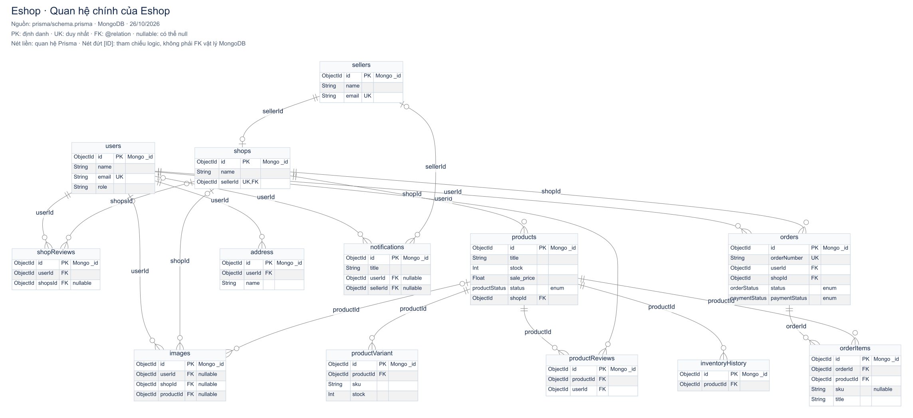
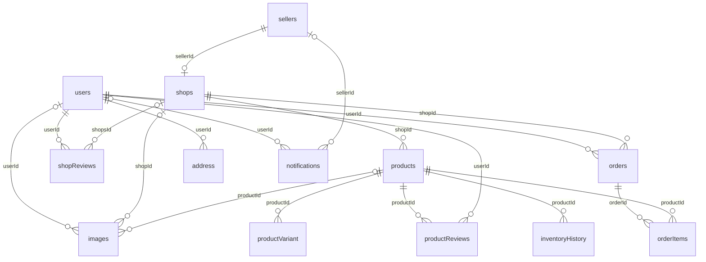

# Sơ đồ cơ sở dữ liệu Eshop

Ngày lập: **26/10/2026**. Nguồn: [prisma/schema.prisma](../prisma/schema.prisma).

Schema sử dụng **MongoDB**, gồm **37 model/collection**, **4 enum** và **19 quan hệ khai báo bằng `@relation`**. Tài liệu mô tả mã nguồn tại thời điểm tạo sơ đồ; không xác nhận dữ liệu, index hay ràng buộc đã được đồng bộ trên database đang chạy.

## Xem sơ đồ



- [Sơ đồ tổng quan — PNG](diagrams/database-overview.png): 13 model chính, 18 quan hệ và các trường quan trọng.
- [Sơ đồ đầy đủ — SVG](diagrams/database-full.svg): đủ 37 model, toàn bộ trường scalar, mảng, enum và `Json`; chỉ vẽ 19 quan hệ `@relation`. Phóng to SVG để đọc chi tiết.
- [Mã Mermaid tổng quan](diagrams/database-overview.mmd) và [mã Mermaid đầy đủ](diagrams/database-full.mmd) để chỉnh sửa hoặc chèn vào báo cáo.
- [Danh mục schema và quan hệ — JSON](diagrams/schema-inventory.json): lưu model, trường, ràng buộc, tham chiếu logic và SHA-256 của schema nguồn.

Sáu sơ đồ theo chức năng bổ sung các tham chiếu ID logic bằng nét đứt. Model ngoài nhóm được lặp lại với một số trường để giải thích quan hệ giữa các nhóm.

| Nhóm | Model thuộc nhóm | Sơ đồ |
|---|---|---|
| Tài khoản và cửa hàng | `users`, `sellers`, `shops`, `address`, `images`, `shopReviews`, `oauthIdentity`, `shoppingState` | [SVG](diagrams/database-accounts.svg) · [Mermaid](diagrams/database-accounts.mmd) |
| Sản phẩm và tồn kho | `products`, `productVariant`, `productReviews`, `inventoryHistory`, `discountCodes`, `productAnalytics`, `site_config` | [SVG](diagrams/database-catalog.svg) · [Mermaid](diagrams/database-catalog.mmd) |
| Đơn hàng và thanh toán | `orders`, `orderItems`, `paymentSession`, `paymentReceipt`, `orderEvent`, `returnRequest` | [SVG](diagrams/database-orders.svg) · [Mermaid](diagrams/database-orders.mmd) |
| Tin nhắn và thông báo | `conversationGroup`, `Participant`, `message`, `chatAttachment`, `pushSubscription`, `notifications` | [SVG](diagrams/database-chat.svg) · [Mermaid](diagrams/database-chat.mmd) |
| PC Builder và chatbot | `pcBuildTemplate`, `savedPcBuild`, `chatbotConversation`, `chatbotMessage` | [SVG](diagrams/database-pc-builder.svg) · [Mermaid](diagrams/database-pc-builder.mmd) |
| Quản trị và phân tích | `adminAudit`, `adminGuard`, `notificationJob`, `behaviorLog`, `log_config`, `userAnalytics` | [SVG](diagrams/database-operations.svg) · [Mermaid](diagrams/database-operations.mmd) |

## Cách đọc

| Ký hiệu | Ý nghĩa |
|---|---|
| `PK` | Trường `@id`, định danh document; mọi `id` đều map thành `_id` trong MongoDB. |
| `UK` | Trường có `@unique`; các unique ghép được liệt kê riêng bên dưới. |
| `FK` | Trường được một quan hệ Prisma sử dụng trong `fields: [...]`; **không phải khóa ngoại vật lý do MongoDB thực thi**. |
| `nullable` | Trường có dấu `?` trong Prisma, cho phép không có giá trị. |
| `[]` | Mảng giá trị; các trường `Json`/`Json[]` giữ nguyên dạng dữ liệu nhúng. |
| Nét liền `--` | Quan hệ khai báo bằng `@relation`. |
| Nét đứt `..`, nhãn `[ID]` | Tham chiếu logic bằng ID hoặc mảng ID, không có `@relation`. Không suy ra kiểm tra tồn tại hay xóa dây chuyền. |
| `1`, `0..1`, `0..N` | Đúng một, không hoặc một, không hoặc nhiều bản ghi. Dấu chân quạ là đầu nhiều; vòng tròn là đầu tùy chọn. |

Ví dụ, `users`–`orders` là một người dùng có `0..N` đơn, mỗi đơn gắn với đúng một người dùng. `sellers`–`shops` là một người bán có `0..1` cửa hàng vì `shops.sellerId` bắt buộc và unique. Các quan hệ đến `images` hoặc `notifications` cho phép đầu chủ sở hữu tương ứng là `0..1`.

Schema có **34 khóa chính ObjectId** và **3 khóa chính String thường**: `paymentSession.id`, `paymentReceipt.id`, `adminGuard.id`. `shoppingState.id` và `savedPcBuild.id` là ObjectId dùng chung ID tài khoản theo controller, nhưng không được khai báo `@relation`.

## Quan hệ chính

Sơ đồ gọn sau khớp 13 model và 18 cạnh trong `database-overview.mmd`; quan hệ thứ 19 của schema là `chatbotConversation`–`chatbotMessage`, nằm trong nhóm PC Builder.



## Tham chiếu logic và dữ liệu nhúng

- Tài khoản: `oauthIdentity.userId → users.id`, `shoppingState.id → users.id`, `savedPcBuild.id → users.id`; `users.following[]` lưu ID cửa hàng.
- Sản phẩm: `discountCodes.sellerId → sellers.id`, `products.discount_codes[] → discountCodes.id`, `inventoryHistory.shopId → shops.id`, `productAnalytics.productId → products.id`, `productAnalytics.shopId → shops.id`.
- Đơn hàng: `paymentSession.userId` và `paymentReceipt.userId` tham chiếu người dùng; `paymentReceipt.sessionId → paymentSession.id`, `paymentReceipt.orderIds[] → orders.id`; `orders.discountCodeId → discountCodes.id`, `orderItems.variantId → productVariant.id`. `orderEvent.orderId` và `returnRequest.orderId` tham chiếu đơn; `returnRequest.userId/shopId` tham chiếu người mua/cửa hàng.
- Chat: `Participant`, `message`, `chatAttachment` lưu `conversationId → conversationGroup.id`; `Participant.userId/sellerId` lưu người tham gia. `notifications.orderId → orders.id`.
- PC Builder và phân tích: `pcBuildTemplate.productIds[] → products.id`, `chatbotConversation.userId → users.id`, `userAnalytics.userId → users.id`.

Các mũi tên trên biểu diễn ý nghĩa ID đang dùng, không bổ sung quan hệ vào schema. Những trường đa hình như `actorId`, `senderId`, `creatorId`, `participantIds`, `recipientId`, `targetId` phụ thuộc loại tác nhân/ngữ cảnh nên không được vẽ thành một FK cố định. `behaviorLog.userId` cũng chỉ là `String?`, không có quan hệ Prisma.

Schema không có collection riêng cho giỏ hàng, wishlist hay danh mục: giỏ/yêu thích nằm trong `shoppingState.payload`; danh mục nằm trong `site_config.categories/subCategories`. `savedPcBuild.parts`, `pcBuildTemplate.components`, `custom_specification` và các trường `Json` khác không được tách thành collection giả trên sơ đồ.

`orders.shippingAddress` là bản chụp địa chỉ dạng `Json`, không liên kết tới địa chỉ hiện tại trong `address`. Các trường `orderItems.title/image/color/size/sku/unitPrice/totalPrice` lưu thông tin tại lúc mua để giữ lịch sử khi sản phẩm thay đổi. Schema tự nó không thực thi tính bất biến của các bản chụp này.

## Enum và ràng buộc

| Enum | Giá trị |
|---|---|
| `productStatus` | `Active`, `Inactive`, `Draft`, `Suspended` |
| `orderStatus` | `Pending`, `Confirmed`, `Processing`, `Shipped`, `Delivered`, `Cancelled`, `Returned`, `Refunded` |
| `paymentStatus` | `Pending`, `Paid`, `Failed`, `Refunded` |
| `notificationType` | `NewOrder`, `OrderConfirmed`, `OrderShipped`, `OrderDelivered`, `OrderCancelled`, `OrderRefunded`, `Promotion`, `NewReview`, `LowStock`, `System` |

Ngoài khóa chính, các trường unique đơn gồm `users.email`, `sellers.email`, `shops.sellerId`, `products.slug`, `oauthIdentity.subject`, `pushSubscription.endpoint`, `chatAttachment.url`, `behaviorLog.eventId`, `orders.orderNumber`, `notificationJob.requestKey`, `returnRequest.orderId`, `userAnalytics.userId`, `productAnalytics.productId`.

| Model | Unique ghép `@@unique` |
|---|---|
| `productVariant` | `(productId, sku)`; `(productId, color, size)` |
| `productReviews` | `(productId, userId)` |
| `message` | `(conversationId, senderId, content, createdAt)` |

| Model | Index thường `@@index` |
|---|---|
| `paymentReceipt` | `(sessionId, userId)` |
| `inventoryHistory` | `(shopId, createdAt)` |
| `behaviorLog` | `(action, createdAt)`; `(userId, createdAt)` |
| `orders` | `(createdAt)`; `(status, createdAt)`; `(shopId, createdAt)`; `(paymentStatus, status, createdAt)` |
| `adminAudit` | `(createdAt)`; `(targetId, createdAt)` |
| `notificationJob` | `(status, createdAt)` |
| `orderEvent` | `(orderId, createdAt)` |
| `returnRequest` | `(shopId, status)` |

Index thường không bảo đảm duy nhất. Vì vậy `(sessionId, userId)` của `paymentReceipt` không biến quan hệ với phiên thanh toán thành 1–1 trên schema. Schema cũng **không có unique `(userId, shopsId)` cho `shopReviews`**, dù `productReviews` có unique theo người dùng/sản phẩm.

Các trường tùy chọn của `images` không có ràng buộc XOR để bắt buộc đúng một trong `userId/shopId/productId`. Tương tự, `Participant.userId/sellerId` và `notifications.userId/sellerId` không có ràng buộc XOR; sơ đồ không ngầm áp đặt chỉ một đầu được điền. Các kiểm tra nghiệp vụ ở ứng dụng cần được xem riêng.

## Tạo lại sau khi sửa schema

Chạy tại thư mục gốc dự án:

```sh
node scripts/generate-database-diagrams.cjs
```

Script chỉ đọc schema, không kết nối hoặc sửa database. Nó cập nhật **8 tệp Mermaid**, `schema-inventory.json` và trình render cục bộ `tmp/database-diagrams/index.html`. Trình render dùng Mermaid từ CDN. **Các bản SVG/PNG đã xuất không tự cập nhật theo lệnh này**; cần render/xuất lại sau khi đổi schema và rà soát các tham chiếu logic được khai báo trong script.
